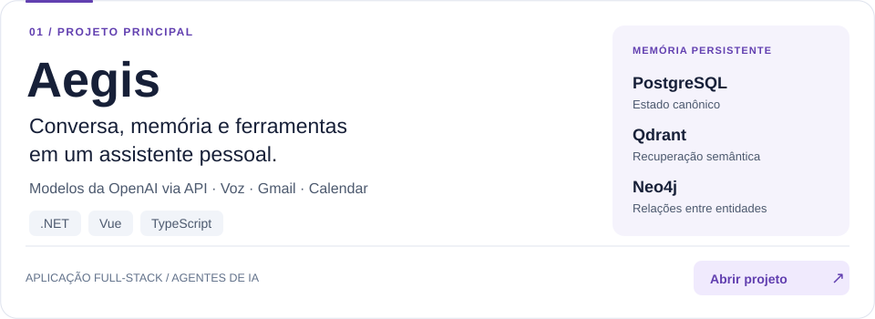
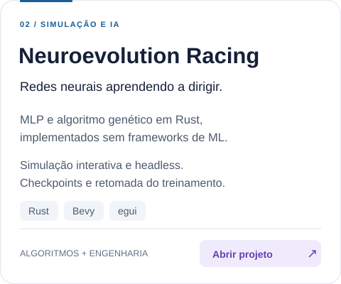
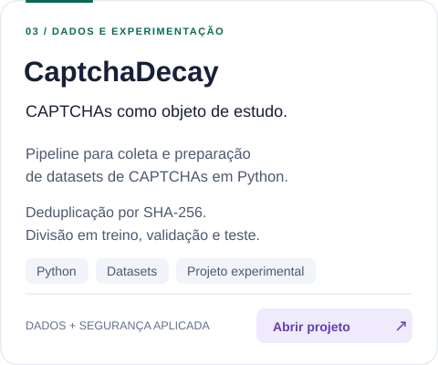

<h1 align="center">Pedro Castello</h1>

<strong>Desenvolvedor de software · Ciência da Computação</strong>

.NET &amp; Vue · Rust · Inteligência Artificial · Segurança da Informação

  <a href="https://www.linkedin.com/in/pedro-hasson-castello-82b2a0160"><picture><source media="(prefers-color-scheme: dark)" srcset="assets/profile/linkedin-dark.svg"></picture></a>
  <a href="mailto:dev.pedrocastello@gmail.com"><picture><source media="(prefers-color-scheme: dark)" srcset="assets/profile/email-dark.svg"></picture></a>

Sou estudante de **Ciência da Computação na Unicentro** e trabalho com **backend .NET e frontend Vue**. Nos meus projetos, exploro agentes de IA, algoritmos evolutivos e segurança aplicada.

Gosto de construir ferramentas que eu mesmo usaria — e de entender os sistemas por trás delas.

## Projetos em destaque

<!-- O card inteiro é um link. As imagens ficam neste repositório, sem serviços de cards externos. -->

  <a href="https://github.com/phcastello/Aegis">
    <picture>
      <source media="(max-width: 600px) and (prefers-color-scheme: dark)" srcset="assets/profile/aegis-mobile-dark.svg">
      <source media="(max-width: 600px)" srcset="assets/profile/aegis-mobile-light.svg">
      <source media="(prefers-color-scheme: dark)" srcset="assets/profile/aegis-dark.svg">
      
    </picture>
  </a>

  <a href="https://github.com/phcastello/Neuroevolution-Racing"><picture><source media="(prefers-color-scheme: dark)" srcset="assets/profile/racing-dark.svg"></picture></a>
  &nbsp;
  <a href="https://github.com/phcastello/CaptchaDecay"><picture><source media="(prefers-color-scheme: dark)" srcset="assets/profile/captcha-dark.svg"></picture></a>

  
<strong>Outros projetos</strong>

   
  
<a href="https://github.com/phcastello/Codex-Guard"><strong>Codex Guard</strong></a> — ferramenta de terminal para acompanhar cotas e controlar o orçamento de créditos de sessões do Codex.

  
<a href="https://github.com/phcastello/AutoApply/tree/mvp-assisted"><strong>AutoApply</strong></a> — adaptação de um projeto open source para candidaturas assistidas. <em>Fork de <a href="https://github.com/AbhishekMandapmalvi/AutoApply">Abhishek Mandapmalvi</a>.</em>

## Tecnologias

**No trabalho:** .NET e Vue. **Nos projetos:** Rust, Python, IA aplicada e infraestrutura.

| Área | Tecnologias |
| :--- | :--- |
| **Linguagens** | `C#` · `Rust` · `Python` · `JavaScript` · `TypeScript` · `C` · `C++` · `Java` |
| **Frontend** | `Vue` · `HTML` · `CSS` |
| **Backend** | `.NET / ASP.NET Core` · `FastAPI` · `Django` |
| **Bancos e recuperação de dados** | `PostgreSQL` · `Redis` · `Qdrant` · `Neo4j` |
| **Simulação e interfaces** | `Bevy` · `egui` |
| **Infraestrutura e versionamento** | `Docker` · `Linux` · `Git` |

---

Software útil. Sistemas bem compreendidos. Atenção aos detalhes.

